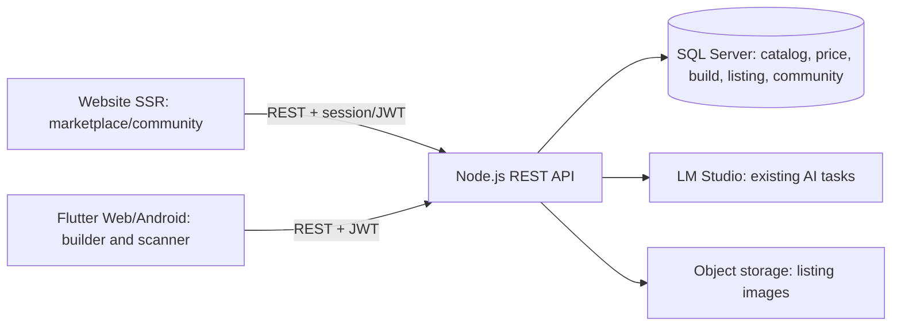

# Kế hoạch website marketplace, cộng đồng và PC Builder

> **Trạng thái:** kế hoạch kiến trúc và chuẩn bị sản phẩm. Chưa thay đổi API, database hoặc runtime.

## Tầm nhìn

Tạo một hệ sinh thái PCBUILD dùng chung tài khoản và dữ liệu giữa website với ứng dụng hiện tại:

- **Website:** nơi khám phá linh kiện/máy tính, đăng bán hoặc trao đổi, thảo luận cộng đồng và chia sẻ cấu hình PC.
- **Ứng dụng Flutter:** tiếp tục phục vụ trải nghiệm build PC, quét linh kiện và các luồng di động; có thể mở thẳng nội dung website qua deep link.
- **Backend Node.js:** cung cấp REST API dùng chung cho website và ứng dụng.
- **SQL Server:** nguồn có thẩm quyền cho tài khoản, catalog, giá thị trường, build, listing, offer và nội dung cộng đồng.
- **LM Studio:** chỉ hỗ trợ các tác vụ AI hiện có; không quyết định giá, tình trạng giao dịch, quyền sở hữu hay khả năng tương thích.

Website công khai cần hiển thị listing và bài viết dưới dạng trang có URL ổn định, metadata và nội dung có thể được tìm kiếm. Tài liệu Flutter khuyến nghị Flutter Web cho trải nghiệm kiểu ứng dụng và nêu rằng trang nhiều nội dung văn bản/SEO phù hợp hơn với HTML truyền thống; Next.js hỗ trợ render trang trên server và metadata theo nội dung. Vì vậy, **đề xuất** làm website công khai riêng bằng Next.js, còn Flutter giữ vai trò ứng dụng/build PC. Đây là lựa chọn cần chốt trước khi khởi tạo frontend mới. [Flutter Web FAQ](https://docs.flutter.dev/platform-integration/web/faq) · [Next.js Server and Client Components](https://nextjs.org/docs/app/getting-started/server-and-client-components) · [Next.js Metadata](https://nextjs.org/docs/app/getting-started/metadata-and-og-images)

## Phạm vi sản phẩm đề xuất

| Nhóm người dùng | Việc họ cần làm |
| --- | --- |
| Khách chưa đăng nhập | Tìm linh kiện/listing, xem bài cộng đồng và cấu hình được chia sẻ công khai. |
| Thành viên/người mua | Lưu bài, liên hệ người bán, gửi đề nghị mua/đổi và tham gia thảo luận. |
| Người bán | Tạo hồ sơ cơ bản, đăng/sửa/ẩn listing, trả lời đề nghị và quản lý trao đổi. |
| Điều phối viên | Tiếp nhận báo cáo, ẩn nội dung vi phạm, xử lý tranh chấp nội dung và lưu dấu vết thao tác. |

### MVP nên có

1. Trang công khai cho catalog, listing và bài cộng đồng; tìm kiếm, lọc theo loại linh kiện, tình trạng, khu vực và khoảng giá.
2. Listing hỗ trợ ba hình thức: **bán**, **đổi**, **cho/tặng**. Giá người bán đưa ra là giá chào, không ghi đè giá thị trường trong `dbo.market`.
3. Thành viên tạo, sửa, đóng và xem trạng thái listing của chính mình; listing có thể gắn `productId` catalog nếu người bán xác nhận đúng SKU.
4. Gửi offer mua/đổi và trao đổi riêng giữa hai thành viên.
5. Bài viết cộng đồng, bình luận, báo cáo nội dung và hàng đợi điều phối tối thiểu.
6. Chia sẻ build dưới dạng snapshot chỉ đọc. Người dùng phải chủ động xác nhận trước khi dùng build riêng để tạo bản nháp listing.
7. Link website mở đúng màn hình trong ứng dụng khi có app; nếu chưa cài app, vẫn xem được trang web.

### Chưa đưa vào MVP

- Thu tiền, ví, escrow, hoàn tiền, vận chuyển và xử lý tranh chấp thanh toán.
- Đấu giá, cửa hàng đa chi nhánh, đồng bộ tồn kho, quảng cáo trả phí và đánh giá người bán phức tạp.
- Cho AI tự định giá, tự xác nhận tình trạng hàng hoặc tự duyệt listing.

MVP chỉ ghi nhận trạng thái trao đổi/offer. Thanh toán có thể thực hiện ngoài nền tảng theo thỏa thuận; cần chính sách pháp lý, hỗ trợ và hoàn tiền riêng trước khi tích hợp cổng thanh toán.

## Kiến trúc và ranh giới



- Website và Flutter chỉ gọi REST API; không kết nối trực tiếp tới SQL Server hoặc LM Studio.
- Tiếp tục dùng các route hiện có cho auth, products, market, builds, compatibility, scans, notifications và price alerts. Thêm namespace mới dưới `/api/v1/marketplace` và `/api/v1/community`; cập nhật OpenAPI cùng mỗi route.
- Website SSR gọi backend từ server để render trang công khai; metadata và Open Graph lấy từ dữ liệu listing/bài viết. Token, SQL credentials và LM Studio key không được đưa vào bundle trình duyệt.
- Luồng đăng nhập website cần thống nhất cách giữ JWT an toàn. Trước khi code, quyết định giữa session cookie `HttpOnly/Secure/SameSite` qua BFF và cơ chế cookie được backend hỗ trợ; không lưu refresh/access token nhạy cảm trong URL.
- Ảnh listing lưu ở object storage; SQL chỉ lưu khóa object, kích thước, MIME, thứ tự và trạng thái duyệt. Không lưu ảnh listing dạng base64 trong SQL. Giới hạn dung lượng, loại file và số ảnh.
- Không dùng chung `dbo.conversations`/`dbo.messages` hiện tại cho chat mua bán: chúng thuộc lịch sử chat AI. Chat marketplace cần quyền và vòng đời dữ liệu riêng.

## Mô hình dữ liệu sơ bộ

Các bảng hiện có trong runtime gồm tài khoản, khu vực, sản phẩm, giá thị trường, build, thông báo, scan, cảnh báo giá và hội thoại AI. Kế hoạch dưới đây là **đề xuất**, không phải schema đã triển khai.

| Nhóm | Bảng đề xuất | Nội dung chính |
| --- | --- | --- |
| Người bán | `seller_profiles` | Hồ sơ công khai, trạng thái xác minh và tùy chọn liên hệ; không lưu thông tin nhạy cảm không cần thiết. |
| Marketplace | `marketplace_listings`, `marketplace_listing_images` | Người sở hữu, loại bán/đổi/tặng, tiêu đề, mô tả, tình trạng, giá chào, khu vực, `productId` tùy chọn, ảnh và trạng thái duyệt. |
| Offer | `marketplace_offers` | Listing, người gửi, loại offer, giá/đề nghị đổi, trạng thái, thời hạn và dấu thời gian. |
| Chat | `marketplace_conversations`, `marketplace_participants`, `marketplace_messages` | Thành viên tham gia, listing liên quan, nội dung, trạng thái chặn/báo cáo và quyền truy cập theo người tham gia. |
| Cộng đồng | `community_posts`, `community_comments`, `community_reactions` | Tác giả, chủ đề, nội dung, trạng thái công khai, bình luận và tương tác. |
| Tin cậy | `content_reports`, `moderation_actions`, `audit_events` | Báo cáo, lý do, quyết định điều phối và lịch sử thao tác. |

Các quyết định dữ liệu cần giữ:

- `productId` chỉ là liên kết catalog do người bán chọn/xác nhận; hàng cũ hoặc cấu hình tự ráp có thể không có SKU chuẩn.
- Giá listing là **giá chào của người bán**; `dbo.market` tiếp tục đại diện giá thị trường theo nguồn hiện có.
- Build riêng tư không tự chuyển thành listing. Khi chia sẻ, tạo snapshot đã lọc dữ liệu cá nhân và cho người dùng duyệt trước.
- Mỗi lệnh sửa/xóa phải kiểm tra chủ sở hữu ở backend; không tin `userId` do client gửi.
- Xác định thời hạn lưu tin nhắn, ảnh, dữ liệu báo cáo và cách xóa tài khoản trước khi phát hành.

## API dự kiến

Tên route dưới đây chỉ là bản nháp để thống nhất hợp đồng, chưa triển khai:

```text
GET    /api/v1/marketplace/listings
POST   /api/v1/marketplace/listings
GET    /api/v1/marketplace/listings/:id
PATCH  /api/v1/marketplace/listings/:id
POST   /api/v1/marketplace/listings/:id/offers
GET    /api/v1/marketplace/me/listings
GET    /api/v1/marketplace/me/offers

GET    /api/v1/community/posts
POST   /api/v1/community/posts
GET    /api/v1/community/posts/:id
POST   /api/v1/community/posts/:id/comments
POST   /api/v1/community/reports

POST   /api/v1/builds/:id/share
POST   /api/v1/builds/:id/listing-draft
```

API cần phân trang, lọc hợp lệ, giới hạn tốc độ, kiểm tra quyền sở hữu, kiểm tra trạng thái trước khi đổi listing/offer và trả lỗi nhất quán. Route ghi dữ liệu phải có test ownership, validation và quyền truy cập; OpenAPI là hợp đồng để tạo client web có kiểu dữ liệu.

## Luồng màn hình chính

```text
Trang chủ
 ├─ Marketplace → tìm kiếm/lọc → listing → hỏi/offer → hội thoại
 ├─ Cộng đồng → chủ đề → bài viết → bình luận/báo cáo
 ├─ Build PC → mở Flutter builder hoặc trang build chia sẻ
 └─ Tài khoản → listing của tôi / offer / bài viết / cài đặt
```

URL công khai dự kiến: `/marketplace`, `/marketplace/:slug`, `/community`, `/community/:slug`, `/build/share/:token`. Trang đăng nhập, chat, quản lý listing và hồ sơ cá nhân cần yêu cầu xác thực. Token chia sẻ build phải khó đoán, có thể thu hồi và không làm lộ build chưa công khai.

## Các giai đoạn triển khai

### Giai đoạn 0 — Chốt sản phẩm

- Xác nhận phạm vi MVP, đối tượng người dùng, quy tắc hàng cũ/bảo hành và khu vực hoạt động.
- Chọn website riêng hay mở rộng Flutter Web; đề xuất hiện tại là website SSR riêng cho trang công khai và tiếp tục dùng Flutter cho builder/mobile.
- Chốt xác thực web, tên miền/API công khai, dịch vụ lưu ảnh, chính sách nội dung, quy trình báo cáo và cách liên hệ khi có sự cố.
- Vẽ wireframe cho trang listing, trang chi tiết, tạo listing, offer/chat, cộng đồng và điều phối.

### Giai đoạn 1 — Nền backend và dữ liệu

- Viết migration/schema mới cho marketplace/community sau khi xác định database đích và có kế hoạch backup/rollback.
- Thêm API listing, offer, chat riêng và moderation; giữ tương thích với các route app hiện tại.
- Thêm lưu ảnh an toàn, quyền sở hữu, audit, giới hạn tần suất và test.

### Giai đoạn 2 — Website công khai

- Tạo ứng dụng website mới, layout responsive, server-rendered listing/bài viết, metadata, sitemap và trang lỗi/404.
- Tích hợp REST client dùng OpenAPI; không đưa secrets backend vào client.
- Thêm tìm kiếm, lọc, phân trang và trang chi tiết.

### Giai đoạn 3 — Giao dịch và cộng đồng

- Hồ sơ người bán, tạo/sửa/ẩn listing, offer mua/đổi, thông báo và hội thoại.
- Bài viết/bình luận, báo cáo và giao diện điều phối tối thiểu.
- Thêm giới hạn spam, chặn người dùng, lịch sử trạng thái và cảnh báo rủi ro.

### Giai đoạn 4 — Kết nối PC Builder và ứng dụng

- Chia sẻ build snapshot có quyền thu hồi; mở deep link qua website/app.
- Tạo bản nháp listing từ build chỉ sau khi chủ sở hữu xác nhận nội dung/linh kiện/giá.
- Flutter app hiển thị thông báo và liên kết listing/community dùng chung tài khoản.

### Giai đoạn 5 — Mở rộng sau MVP

- Đo nhu cầu thực tế rồi mới quyết định đơn hàng, vận chuyển, đánh giá, xác minh nâng cao và thanh toán.
- Nếu tích hợp thanh toán, cần thiết kế webhook idempotent, đối soát, hoàn tiền, hỗ trợ và bảo vệ tranh chấp trước khi bật.

## Tiêu chí nghiệm thu MVP

1. Khách xem được trang listing/bài viết công khai có URL riêng và nội dung render được khi tải trực tiếp.
2. Thành viên tạo và quản lý listing của chính mình; không thể sửa listing của người khác.
3. Giá chào không làm thay đổi dữ liệu `dbo.market`; SKU chỉ hiện khi được gắn với sản phẩm catalog hợp lệ.
4. Buyer/seller gửi offer và trao đổi trong hội thoại riêng; người ngoài không đọc được.
5. Người dùng có thể báo cáo listing/bài viết; moderator có thể ẩn và ghi lại lý do xử lý.
6. Build chỉ được công khai sau thao tác xác nhận; có thể thu hồi link chia sẻ.
7. Flutter, website và backend không truy cập SQL trực tiếp từ client; AI không tự quyết giá hoặc quyền giao dịch.
8. Có test API cho auth/ownership/validation/moderation và smoke test liên kết website–app trên môi trường staging.

## Quyết định cần chốt trước khi bắt đầu code

- Website SSR riêng có được duyệt không? Nếu có, chọn Next.js hay stack khác và nơi hosting.
- Bán/đổi ban đầu giới hạn ở linh kiện/PC hay mở thêm dịch vụ, phụ kiện và bài tìm mua?
- Giao dịch gặp trực tiếp, giao hàng hay cả hai? Ai chịu trách nhiệm khi hàng không đúng mô tả?
- Có cho phép thanh toán trong nền tảng ở MVP không? **Đề xuất: chưa**, để giảm rủi ro vận hành/pháp lý.
- Quy định hồ sơ người bán, hàng cấm, bảo hành, hoàn trả, thông tin liên hệ và lưu dữ liệu là gì?
- Dịch vụ lưu ảnh nào được dùng, dung lượng tối đa và thời gian lưu bao lâu?
- Tên miền, thương hiệu và API public URL nào sẽ cấp cho website?

## Những gì đã chuẩn bị từ repo hiện tại

- Có thể tái sử dụng auth, SQL catalog/market, build, compatibility, notifications, scans và REST/OpenAPI.
- Marketplace listing, offer và nội dung cộng đồng chưa có trong runtime hiện tại; cần bổ sung API/domain riêng.
- Hội thoại hiện có thuộc chat AI; không dùng trực tiếp làm chat người mua–người bán.
- Chưa sửa code runtime, chưa tạo migration và chưa kết nối/ghi schema SQL trong lúc lập kế hoạch.
